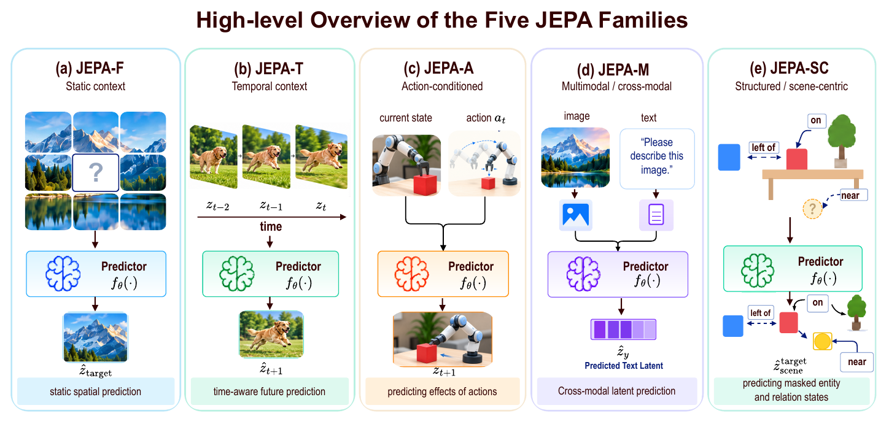

<h1 align="center">From Joint-Embedding Prediction to World Models: A Survey</h1>

<p align="center">
  Ziying Song<sup>*</sup> · Qing Wang<sup>*</sup> · Peiliang Wu · Hao Yang · Yanchen Huo<br>
  Lei Yang · Li Wang · Yadan Luo · Zheng Zhu
</p>

<p align="center">
  <sup>*</sup> Equal contribution · Manuscript in preparation
</p>

<p align="center">
  <a href="https://catqing521.github.io/jepa-world-models-survey/paper/survey.pdf"></a>
  <a href="https://catqing521.github.io/jepa-world-models-survey/"></a>
  <a href="https://catqing521.github.io/jepa-world-models-survey/dist/#collection"></a>
</p>

<p align="center">
  <a href="https://catqing521.github.io/jepa-world-models-survey/paper/survey.pdf#page=6"></a>
  <br>
  <sub>Prediction patterns in the five JEPA families (Figure 3 of the manuscript).</sub>
</p>

This repository accompanies a survey of **Joint-Embedding Predictive Architectures (JEPAs)** and their development toward world models. JEPAs learn to predict target representations from context without reconstructing the full observation. The survey follows this idea from masked image regions to video, action-conditioned dynamics, multimodal signals, and structured scenes.

- **Five method families** group work by its primary prediction task.
- **R/P/I/C** evaluates what experiments demonstrate about representation, prediction, intervention, and control.
- **Benchmark guide** maps the families to datasets, tasks, metrics, and results reported by the original studies.

## Table of Contents

- [Methods](#methods)
  - [JEPA-F: Foundational and Static](#jepa-f-foundational-and-static)
  - [JEPA-T: Temporal](#jepa-t-temporal)
  - [JEPA-A: Action-Conditioned](#jepa-a-action-conditioned)
  - [JEPA-M: Multimodal](#jepa-m-multimodal)
  - [JEPA-SC: Structured and Scene-Centric](#jepa-sc-structured-and-scene-centric)
- [Capability Evidence](#capability-evidence)
- [Benchmarks and Datasets](#benchmarks-and-datasets)
- [Applications and Open Problems](#applications-and-open-problems)
- [Contributing](#contributing)
- [Citation](#citation)
- [Repository and Local Preview](#repository-and-local-preview)

## Methods

The tables below list the 26 representative entries from the [searchable method collection](https://catqing521.github.io/jepa-world-models-survey/dist/#collection), grouped by each method's primary family in the manuscript (some methods span multiple families). **Source** lists the publication venue or preprint.

### JEPA-F: Foundational and Static

Predict masked or missing features from the same observation, such as image regions or tabular variables.

| Year | Source | Method | Paper | Code / Project |
| ---: | --- | --- | --- | --- |
| 2023 | CVPR | **I-JEPA** | [Self-Supervised Learning From Images With a Joint-Embedding Predictive Architecture](https://openaccess.thecvf.com/content/CVPR2023/html/Assran_Self-Supervised_Learning_From_Images_With_a_Joint-Embedding_Predictive_Architecture_CVPR_2023_paper.html) | [Code](https://github.com/facebookresearch/ijepa) |
| 2024 | arXiv | **DMT-JEPA** | [Discriminative Masked Targets for Joint-Embedding Predictive Architecture](https://arxiv.org/abs/2405.17995) | — |
| 2025 | arXiv | **Discrete JEPA** | [Learning Discrete Token Representations without Reconstruction](https://arxiv.org/abs/2506.14373) | — |
| 2025 | arXiv | **SparseJEPA** | [Sparse Representation Learning of Joint Embedding Predictive Architectures](https://arxiv.org/abs/2504.16140) | — |
| 2025 | ICLR | **T-JEPA** | [Augmentation-Free Self-Supervised Learning for Tabular Data](https://openreview.net/forum?id=gx3LMRB15C) | [Code](https://github.com/jose-melo/t-jepa) |

### JEPA-T: Temporal

Learn from video or time series by predicting masked temporal segments or future latent states.

| Year | Source | Method | Paper | Code / Project |
| ---: | --- | --- | --- | --- |
| 2023 | arXiv | **MC-JEPA** | [A Joint-Embedding Predictive Architecture for Self-Supervised Learning of Motion and Content Features](https://arxiv.org/abs/2307.12698) | — |
| 2024 | TMLR | **V-JEPA** | [Revisiting Feature Prediction for Learning Visual Representations from Video](https://openreview.net/forum?id=QaCCuDfBk2) | [Code](https://github.com/facebookresearch/jepa) |
| 2025 | arXiv | **V-JEPA 2** | [Self-Supervised Video Models Enable Understanding, Prediction and Planning](https://arxiv.org/abs/2506.09985) | [Code](https://github.com/facebookresearch/vjepa2) |
| 2026 | arXiv | **Branch-JEPA** | [Finite-Support Predictive Distributions for JEPA World Models](https://arxiv.org/abs/2607.05238) | — |
| 2026 | Knowledge-Based Systems | **CF-JEPA** | [Mask-free forward prediction with asymmetric encoder utilization for time-series representation learning](https://www.sciencedirect.com/science/article/pii/S0950705126020319) | [Code](https://github.com/WDSLab/CF-JEPA) |
| 2026 | arXiv | **UWM-JEPA** | [Predictive World Models That Imagine in Belief Space](https://arxiv.org/abs/2605.25313) | — |

### JEPA-A: Action-Conditioned

Condition future latent-state prediction on actions for planning, or jointly learn latent prediction and action policies.

| Year | Source | Method | Paper | Code / Project |
| ---: | --- | --- | --- | --- |
| 2025 | arXiv | **V-JEPA 2-AC** | [V-JEPA 2: Self-Supervised Video Models Enable Understanding, Prediction and Planning](https://arxiv.org/abs/2506.09985) | [Code](https://github.com/facebookresearch/vjepa2) |
| 2026 | IEEE Access | **ACT-JEPA** | [Novel joint-embedding predictive architecture for efficient policy representation learning](https://doi.org/10.1109/ACCESS.2026.3696039) | — |
| 2026 | arXiv | **Fast-LeWM** | [Fast LeWorldModel](https://arxiv.org/abs/2606.26217) | [Project](https://fast-lewm.github.io/) |
| 2026 | arXiv | **LeWM** | [LeWorldModel: Stable End-to-End Joint-Embedding Predictive Architecture from Pixels](https://arxiv.org/abs/2603.19312) | [Code](https://github.com/lucas-maes/le-wm) |
| 2026 | arXiv | **Sub-JEPA** | [Subspace Gaussian Regularization for Stable End-to-End World Models](https://arxiv.org/abs/2605.09241) | [Code](https://github.com/intcomp/Sub-JEPA) |

V-JEPA 2-AC is the action-conditioned extension reported in the V-JEPA 2 paper.

### JEPA-M: Multimodal

Predict or align representations across modalities such as vision, language, audio, and robot sensors.

| Year | Source | Method | Paper | Code / Project |
| ---: | --- | --- | --- | --- |
| 2025 | ICML | **M3-JEPA** | [Multimodal Alignment via Multi-gate MoE based on the Joint-Embedding Predictive Architecture](https://proceedings.mlr.press/v267/lei25b.html) | [Code](https://github.com/HongyangLL/M3-JEPA) |
| 2026 | arXiv | **AquaJEPA** | [An Action-Conditioned Multimodal JEPA Family for Underwater Robot Dynamics](https://arxiv.org/abs/2607.29393) | — |
| 2026 | arXiv | **AV-JEPA** | [Extending LeJEPA to Audio-Visual Self-Supervised Learning](https://arxiv.org/abs/2607.15295) | [Code](https://github.com/AaltoML/LeAVJEPA) |
| 2026 | CVPR Workshop | **Le MuMo JEPA** | [Multi-Modal Self-Supervised Representation Learning with Learnable Fusion Tokens](https://arxiv.org/abs/2603.24327) | [Code](https://github.com/ciemcornelissen/le-mumo-jepa) |
| 2026 | ECCV | **MJEPA** | [A Simple and Scalable Joint-Embedding Predictive Architecture for Audio-Visual Learning](https://arxiv.org/abs/2606.25225) | [Code](https://github.com/facebookresearch/MJEPA) |
| 2026 | ICLR | **VL-JEPA** | [Joint Embedding Predictive Architecture for Vision-Language](https://openreview.net/forum?id=tjimrqc2BU) | — |

### JEPA-SC: Structured and Scene-Centric

Predict representations of points, objects, geometry, or relationships within a scene.

| Year | Source | Method | Paper | Code / Project |
| ---: | --- | --- | --- | --- |
| 2024 | arXiv | **3D-JEPA** | [A Joint Embedding Predictive Architecture for 3D Self-Supervised Representation Learning](https://arxiv.org/abs/2409.15803) | — |
| 2025 | WACV | **Point-JEPA** | [A Joint Embedding Predictive Architecture for Self-Supervised Learning on Point Cloud](https://doi.org/10.1109/WACV61041.2025.00714) | — |
| 2026 | ICML | **Causal-JEPA** | [Learning World Models through Object-Level Latent Masking](https://proceedings.mlr.press/v306/nam26c.html) | [Code](https://github.com/galilai-group/cjepa) |
| 2026 | arXiv | **Cross4D-JEPA** | [Dense Cross-modal Correspondence Distillation for 4D Point Cloud Representation Learning](https://arxiv.org/abs/2607.00514) | — |

## Capability Evidence

[Table 2 of the manuscript](https://catqing521.github.io/jepa-world-models-survey/paper/survey.pdf#page=7) summarizes which capabilities each study tested.

| Capability | Core question |
| --- | --- |
| **R** · Representation | Are the learned features useful on downstream tasks? |
| **P** · Prediction | Does the model predict future states beyond the observed context? |
| **I** · Intervention | Do predictions change appropriately when the action changes? |
| **C** · Control | Does a system use prediction to choose and revise actions under feedback? |

For control, **C<sub>sys</sub>** evaluates full closed-loop system performance, while **C<sub>attr</sub>** isolates the predictive component's contribution. In Table 2, **D** marks a direct test, **Q** marks related but incomplete evidence, and **—** marks no sufficient reported test.

## Benchmarks and Datasets

[Table 3](https://catqing521.github.io/jepa-world-models-survey/paper/survey.pdf#page=8) maps each family to its evaluation tasks and metrics, and Tables 4–8 summarize results quoted from the original papers. Numerical results are directly comparable only under matched tasks, data splits, and evaluation protocols (accounting for backbone size, training data, and adaptation).

| Family | Benchmarks and tasks | Metrics | Results |
| --- | --- | --- | --- |
| [JEPA-F](#jepa-f-foundational-and-static) | ImageNet-1K classification, ADE20K semantic segmentation, COCO detection and instance segmentation, DAVIS-2017 video object segmentation | Linear, fine-tuned, and 1% classification accuracy, mIoU, box/mask AP, J&F, J, F | [Table 4](https://catqing521.github.io/jepa-world-models-survey/paper/survey.pdf#page=11) |
| [JEPA-T](#jepa-t-temporal) | Something-Something V2 and Kinetics-400 action recognition, EPIC-KITCHENS-100 action anticipation | Top-1 accuracy, action mcR@5 | [Table 5](https://catqing521.github.io/jepa-world-models-survey/paper/survey.pdf#page=12) |
| [JEPA-A](#jepa-a-action-conditioned) | Two-Room navigation, Reacher, PushT, Cube | Task success rate and four-task average | [Table 6](https://catqing521.github.io/jepa-world-models-survey/paper/survey.pdf#page=12) |
| [JEPA-M](#jepa-m-multimodal) | COCO image–text retrieval, video–language retrieval and classification, AudioSet AS-20K audio–visual event classification | Retrieval R@1, classification accuracy, mAP | [Table 7](https://catqing521.github.io/jepa-world-models-survey/paper/survey.pdf#page=13) |
| [JEPA-SC](#jepa-sc-structured-and-scene-centric) | ScanObjectNN PB-T50-RS object classification, ShapeNetPart part segmentation | Overall accuracy, instance mIoU | [Table 8](https://catqing521.github.io/jepa-world-models-survey/paper/survey.pdf#page=13) |

## Applications and Open Problems

The survey covers image and video understanding, 3D and structured perception, embodied robotics, autonomous driving, vision–language and multimodal agents, and scientific or sequential data. [Table 9](https://catqing521.github.io/jepa-world-models-survey/paper/survey.pdf#page=13) relates application areas to their typical capability requirements.

The open problems include retaining information needed for prediction, modeling the effects of actions, handling uncertainty over longer horizons, tracking objects and their relations as scenes change, and verifying latent predictions efficiently.

## Contributing

For additions or corrections, open an [issue](https://github.com/CatQing521/jepa-world-models-survey/issues) or submit a [pull request](https://github.com/CatQing521/jepa-world-models-survey/pulls). Include the method name, the manuscript citation key when available, and a link to the original study. For a classification change, specify the proposed family and explain how it fits the method's main prediction task.

## Citation

You can cite the current manuscript with the BibTeX entry below. Peiliang Wu is the corresponding author, and full affiliations appear in the [manuscript](https://catqing521.github.io/jepa-world-models-survey/paper/survey.pdf).

```bibtex
@misc{song_jepa_world_models_survey,
  title  = {From Joint-Embedding Prediction to World Models: A Survey},
  author = {Song, Ziying and Wang, Qing and Wu, Peiliang and Yang, Hao and Huo, Yanchen and Yang, Lei and Wang, Li and Luo, Yadan and Zhu, Zheng},
  note   = {Manuscript in preparation},
  url    = {https://catqing521.github.io/jepa-world-models-survey/paper/survey.pdf}
}
```

## Repository and Local Preview

- [`dist/`](./dist/) contains the static project page and searchable collection.
- [`dist/papers.json`](./dist/papers.json) contains the method metadata used by the site.
- [`figures/`](./figures/) contains figures used in this README.
- [`paper/survey.pdf`](./paper/survey.pdf) is the survey manuscript PDF.
- [`index.html`](./index.html) redirects the GitHub Pages root to the project page.

The site can be served from the `main` branch root using GitHub Pages. To preview it locally, run `python3 -m http.server 8000` from the repository root and open [localhost:8000](http://localhost:8000/).
